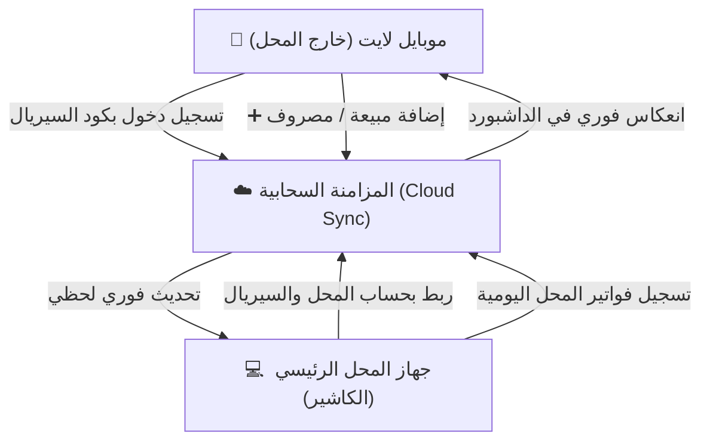

# 🗺️ خارطة طريق مشروع: تطبيق بيان المحاسبي (نسخة الموبايل لايت)
# Bayan POS - Mobile Lite Edition Roadmap

> [!NOTE]
> هذا الملف يمثل الوثيقة المرجعية وخارطة الطريق الرسمية لتطوير النسخة المخصصة للهواتف الذكية **(Bayan Mobile Lite)** كفرع مستقل ومنفصل تماماً داخل المشروع، ليعمل بتناغم سحابي فوري مع التطبيق الرئيسي للمحل.

---

## 📌 1. الرؤية العامة والأهداف (Executive Vision)

* **الهدف الأساسي:** توفير تطبيق ويب تقدمي خفيف وسريع جداً **(Progressive Web App - PWA)** مخصص لشاشات الهواتف الذكية بنظام اللمس.
* **الجمهور المستهدف:** صاحب المحل أو المدير أثناء تواجده بالخارج، أو الكاشير على جهاز هاتف محمول.
* **الاستقلالية التامة:** إنشاء مجلد منفصل `mobile-lite/` يحتوي على كامل ملفات التشغيل (HTML / CSS / JS / Assets / Service Worker) دون أي تداخل في الأكواد مع النسخة الرئيسية.
* **المزامنة السحابية الحية:** الربط الفوري عبر **كود السيريال (Serial Code)**، بحيث تظهر أي عملية مسجلة في المحل فوراً على الموبايل، وأي عملية تسجل من الموبايل تنزل في جدول المحل لحظياً.

---

## 🏗️ 2. الهيكل المعماري للملفات (Project Directory Structure)

```text
📁 BAYAN SOFTWARE WEBSITE/New folder/
├── 📄 index.html                      (النسخة الرئيسية للديسكوتوب/الكاشير)
├── 📄 database-api.js                (محرك قاعدة البيانات Dexie v6)
├── 📁 js/                            (منظومة الديسكوتوب الحالية)
├── 📁 css/                           (تصاميم الديسكوتوب)
│
└── 📁 mobile-lite/                   (👈 مجلد نسخة الموبايل المستقلة بالكامل)
    ├── 📄 index.html                 (واجهة الموبايل الرئيسية)
    ├── 📄 manifest.json              (بيانات تثبيت التطبيق PWA على الهاتف)
    ├── 📄 service-worker.js          (التشغيل الأوفلاين السريع والتخزين المؤقت)
    ├── 📁 css/
    │   ├── 📄 mobile-style.css       (التصميم الزجاجي Glassmorphism للموبايل)
    │   └── 📄 theme-dual.css         (دعم الوضعين: الداكن والفاتح)
    ├── 📁 js/
    │   ├── 📄 app.js                 (منسق التطبيق والتنقل وإدارة الجلسة)
    │   ├── 📄 auth-serial.js         (تسجيل الدخول والتحقق بكود السيريال)
    │   ├── 📄 transactions.js        (إضافة العمليات، كاش، انستا، فودافون كاش)
    │   ├── 📄 cloud-sync.js          (المزامنة السحابية مع الجهاز الرئيسي)
    │   └── 📄 export-share.js        (مشاركة واتساب السريعة والطباعة)
    └── 📁 assets/
        └── 📁 icons/                 (أيقونات الموبايل بأحجام Android و iOS)
```

---

## 🔄 3. مخطط تدفق البيانات والمزامنة (Architecture Flow)



---

## 🚀 4. مراحل التنفيذ التفصيلية (Implementation Phases)

### 🟢 المرحلة 1: التأسيس المعماري المستقل (Folder & Core Setup)
- [x] إنشاء المجلد المستقل `mobile-lite/`.
- [x] بناء هيكل `index.html` بتصميم Mobile-First متجاوب مع أبعاد جميع الهواتف.
- [x] إعداد ملف `manifest.json` وأيقونات الشاشة الرئيسية لتثبيته كتطبيق مستقل على أندرويد وآيفون.
- [x] إعداد `service-worker.js` مخصص للموبايل يضمن العمل بدون نت وحفظ الكاش.

---

### 🎨 المرحلة 2: تصميم وتجربة المستخدم (Mobile UI/UX - Glassmorphism 2.0)
- [x] **تصميم الهيدر والبطاقات المالية (Dashboard Cards):**
  - كارت إجمالي الوارد / المبيعات (فوق 🔝).
  - كارت إجمالي المنصرف / المصروفات (تحت 🔻).
  - كارت صافي أرباح اليوم الفعلي ✨.
  - شريط تفصيلي لحظي لطرق الدفع: (كاش نقدي 💵 | إنستا باي 🟣 | فودافون كاش 🔴).
- [x] **دعم الوضعين الفاتح والداكن (Dual Theme):**
  - وضع داكن أنيق (Dark Glassmorphism) مريح للعين وموفر لبطارية الهاتف.
  - وضع فاتح عالي التباين (Crisp Light Mode) لسهولة القراءة في ضوء النهار.
- [x] **أزرار لمس مريحة وكبيرة (Thumb-friendly Navigation):**
  - شريط تنقل سفلي ثابت (Bottom Navigation Bar) لسهولة الاستخدام بيد واحدة.

---

### ⚡ المرحلة 3: محرك العمليات ونظام السيريال السحابي (Logic & Cloud)
- [x] **تسجيل الدخول بالسيريال كود فقط (Serial Authentication):**
  - إدخال كود السيريال الخاص بالمحل لمرة واحدة وحفظ الجلسة الآمنة.
  - التحقق من صلاحية السيريال وسحب إعدادات وهوية المحل تلقائياً.
- [x] **نافذة إضافة عملية سريعة (Bottom Sheet Entry):**
  - تفتح من أسفل الشاشة بنعومة.
  - تحديد الاتجاه: مبيعة واردة (فوق) أو مصروف صادر (تحت).
  - إدخال المبلغ وتحديد طريقة الدفع (كاش / انستا / فودافون كاش).
  - كتابة أو اختيار البند السريع وحفظ العملية فوراً.
- [x] **جدول وسجل العمليات اليومية (Daily Transactions Feed):**
  - عرض العمليات ككروت أنيقة بدلاً من الجداول الضيقة غير المناسبة للهواتف.
  - فلترة فورية بالتواريخ (اليوم، أمس، الأسبوع، الشهر، أو تاريخ مخصص).
- [x] **المزامنة السحابية المزدوجة (Two-Way Live Sync):**
  - ربط فوري مع محرك المزامنة السحابية لنقل العمليات لحظياً بين الموبايل والمحل.

---

### 📲 المرحلة 4: المشاركة الذكية، الطباعة، ومستودع GitHub
- [x] **زر مشاركة واتساب الفوري:**
  - توليد كشف مختصر منسق بالإيموجي لمبيعات ومصروفات اليوم وإرساله بضغطة زر إلى واتساب المدير أو المالك.
- [x] **طباعة وتصدير الإيصالات:**
  - طباعة تقرير تقفيل الوردية اليومي وبون إيصالات حرارية (80mm/58mm) أو تصدير PDF من الموبايل مباشرة.
  - إمكانية طباعة إيصال منفصل لأي عملية محددة للعميل من قائمة الحركات.
- [x] **تجهيز وإعداد مستودع GitHub:**
  - كتابة ملف `README.md` خاص بنسخة الموبايل.
  - إعداد ملفات التكوين لتسهيل رفع المجلد ونشره على GitHub Pages أو أي منصة سحابية.

---

## ⚖️ 5. جدول المقارنة: نسخة الديسكوتوب مقابل نسخة الموبايل لايت

| وجه المقارنة | نسخة الكمبيوتر / الديسكوتوب (الحالية) | نسخة الموبايل لايت (الجديدة) |
|---|---|---|
| **الغرض الرئيسي** | كاشير نقطة بيع متكامل (POS) داخل المحل | تطبيق متابعة وإدخال سريع في جيب المدير/المستخدم |
| **واجهة المستخدم** | جداول عريضة ولوحات تحكم موسعة لشاشات العرض | كروت عمودية وشريط سفلي وتصميم زجاجي للمس |
| **الإعدادات والخيارات** | 12 تبويب إعدادات، أمان، صلاحيات، وجرد مخازن | واجهة مقتضبة تركز 100% على الإيرادات والمصروفات |
| **طريقة الإدخال** | كيبورد، باركود، ماوس، فواتير مفصلة | إدخال لمس سريع، فودافون كاش، إنستاباي، كاش |
| **المزامنة** | تعمل كجهاز رئيسي / كاشير محلي | تعمل كمحطة طرفية متصلة سحابياً بالسيريال |
| **طبيعة الملفات** | داخل المجلد الرئيسي | معزولة في مجلد `mobile-lite/` مستقل تماماً |

---

> 🎯 **جاهزية التنفيذ:** تم إعداد هذه الخارطة لتكون مرجع العمل الفعلي، ونبدأ منها مباشرة بتنفيذ المرحلة الأولى فور الإشارة.
